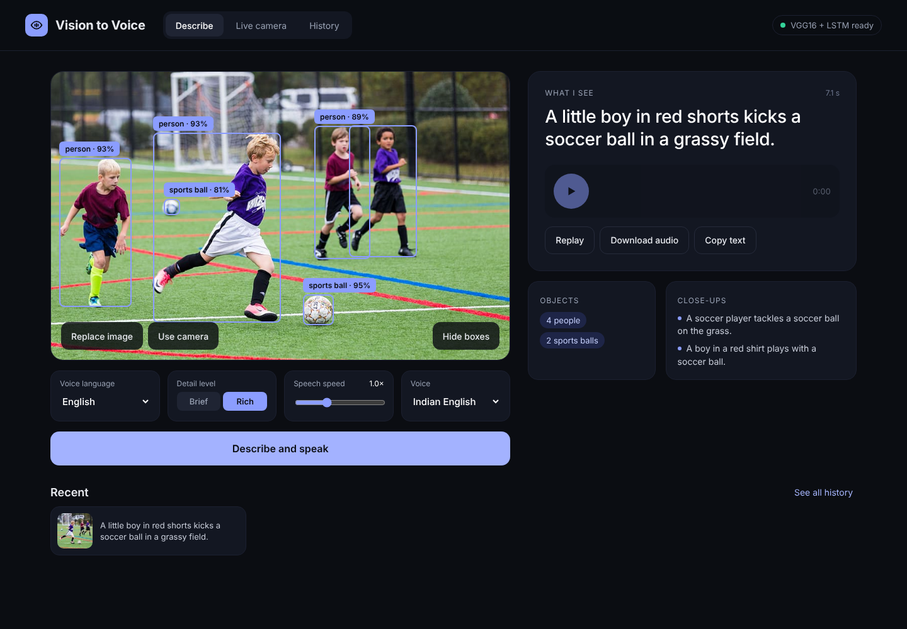
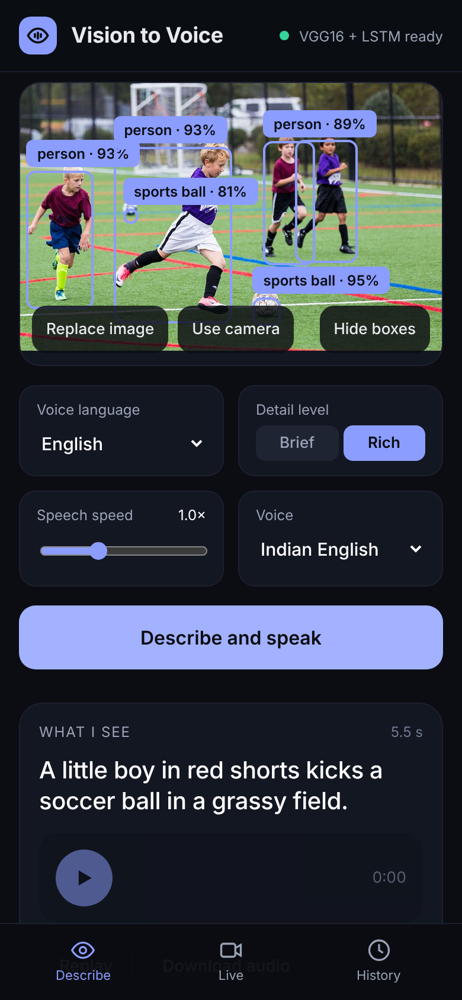

# Vision2Voice web app

A FastAPI backend and a responsive web interface for this project's own **VGG16 + LSTM** captioning model (trained on Flickr8k), with **YOLOv8** object close-ups, a **grammar-polishing** step, and **gTTS** speech.



<p align="center"></p>

*These are real outputs. The trained model `modelConcat_1_89.h5` captioned `capstone_data_2/flickr8k/playing_soccer.jpg` on a CPU in about 5.5 seconds. Speech was turned off when the screenshots were taken, so the player is empty.*

## How it works

```
Image
  │
  ├─► VGG16 (ImageNet, fc2 → 4096-d) ─► LSTM decoder (modelConcat_1_89.h5)
  │                                        beam search, width 10, length-normalised
  │                                        → "little boy in red shorts kicks soccer ball in grassy field"
  │
  ├─► YOLOv8-nano ─► boxes + counts ("4 people, 2 sports balls")
  │       └─► largest crops ─► VGG16 + LSTM again ─► close-up captions
  │
  ▼
text_polish.py ─► "A little boy in red shorts kicks a soccer ball in a grassy field.
                   Up close, a boy in a red shirt plays with a soccer ball."
  │
  ▼
translation (optional) ─► gTTS (Indian / US / UK / Australian English) ─► MP3 in the browser
```

### Grammar polishing

The Flickr8k LSTM drops articles, repeats words and sometimes stops mid-phrase. `text_polish.py` fixes this with rules that are tested on the model's real output:

| Raw model output | Spoken |
|---|---|
| `people are standing on the side of bus` | People are standing on the side of **a** bus. |
| `man in blue shirt is standing next to several basket poles` | **A** man in **a** blue shirt is standing next to several basket poles. |
| `little boy in red shorts kicks soccer ball in grassy field` | A little boy in red shorts kicks **a** soccer ball in **a** grassy field. |
| `man in red and white helmet and helmet riding bike` | A man in a red and white helmet riding **a** bike. |
| `man is spraying fluid on the beach with fishing fishing in the background` | A man is spraying fluid on the beach with fishing in the background. |

- **Articles:** adds "a"/"an" at the start and after prepositions and transitive verbs, but not before plurals, mass nouns ("in water", "black hair", "aerodynamic gear") or sports ("plays soccer", but "kicks a soccer ball").
- **Clean-up:** removes stutters ("bench bench"), repeated phrases, "X and X", leftover `start`/`end` tokens and dangling words; fixes "a" versus "an".
- **Close-up filter:** keeps a crop caption only if it mentions the object YOLO found in that crop (so a horse crop captioned "a dog" is dropped), isn't a near-repeat, and has a reasonable beam score. At most two are spoken.
- **Optional T5 grammar correction** (`vennify/t5-base-grammar-correction`): accepted only when its edit is small, so it can't change the meaning. Turn it off with `ENABLE_GRAMMAR_MODEL=0`.

## Features
- **Describe:** upload, drag and drop, paste, or capture from the camera. *Brief* uses beam width 3 on the whole image only. *Rich* uses beam width 10 plus object close-ups.
- **Live camera:** captions the camera feed every 4 seconds and only speaks when the scene changes.
- **History:** your last 30 descriptions, which can be replayed.
- Detection boxes over the image, a waveform player with speed control, MP3 download, and copy text.
- Two-panel layout on laptops; one column with a bottom navigation bar on phones. Keyboard-accessible (Space plays and pauses).

## Run

```bash
# from the repository root: fetch the trained weights (Git LFS)
git lfs pull --include="capstone_data_2/Saved_Models3/modelConcat_1_89.h5,capstone_data_2/caption_train_tokenizer.pkl"

cd webapp/backend
python -m venv .venv && source .venv/bin/activate      # Windows: .venv\Scripts\activate
pip install -r requirements.txt
uvicorn app:app --host 0.0.0.0 --port 8000
```

Open http://localhost:8000. The first start downloads the VGG16 ImageNet weights (about 530 MB) and `yolov8n.pt` (6 MB). The camera needs `localhost` or HTTPS.

**Docker** (from the repository root): `docker build -f webapp/Dockerfile -t vision2voice-web . && docker run -p 8000:8000 vision2voice-web`

### Notes
- The `.h5` decoder was saved with Keras 2. On Keras 3, `captioner.py` rebuilds the architecture from `Project.ipynb` (`define_model_concat`) and loads the trained weights into it. The tokenizer `.pkl` is read without needing Keras 2.
- YOLO (PyTorch) is loaded before TensorFlow. Loading them the other way round can crash with `LLVM ERROR: inconsistency in registered CommandLine options`.

## Tests
```bash
cd webapp/backend && pytest -q
```
The 10 tests cover the grammar rules (using real model captions) and every API endpoint, with the models stubbed, so they run in under a second.

## API
| Method | Path | Fields (multipart) |
|---|---|---|
| GET | `/api/health` | none |
| POST | `/api/analyze` | `image`, `mode` (`describe`/`live`), `detail` (`rich`/`brief`), `lang`, `accent` (`in`/`us`/`uk`/`au`), `slow`, `speak` |
| POST | `/api/tts` | `text`, `lang`, `accent`, `slow` |

`/api/analyze` returns `caption`, `narration`, `closeups`, `objects`, `detections` (normalised boxes), `raw_caption`, `raw_crop_captions` (with beam scores), `audio_base64`, `audio_mime` and `timings_ms`.

## Configuration
| Variable | Default | Purpose |
|---|---|---|
| `V2V_WEIGHTS_DIR` | `capstone_data_2` | Folder that holds the weights and tokenizer |
| `V2V_MODEL_FILE` | `Saved_Models3/modelConcat_1_89.h5` | Decoder checkpoint |
| `YOLO_MODEL` | `yolov8n.pt` | Detector (`yolov8s.pt` is more accurate) |
| `CROP_MIN_SCORE` | `-1.3` | Minimum beam score for a close-up caption |
| `ENABLE_GRAMMAR_MODEL` | `1` | `0` uses the rules only |
| `PRELOAD` | `1` | `0` loads the models on the first request |
